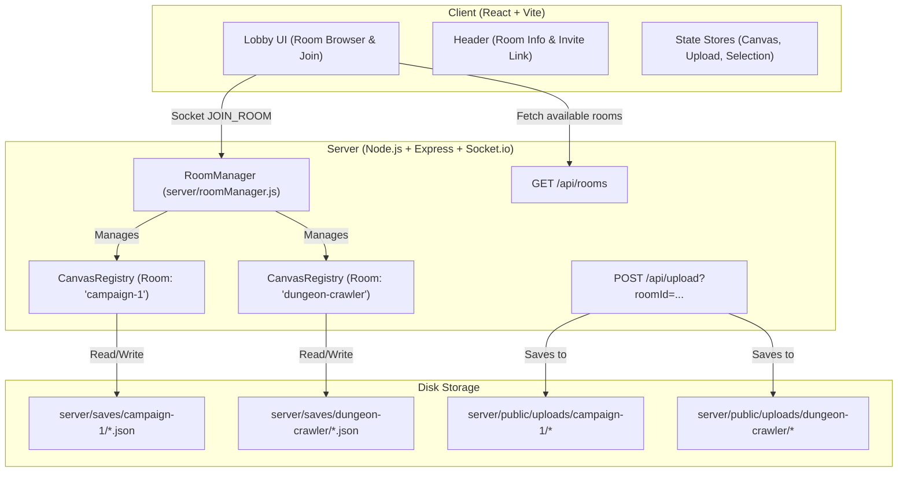

# Implementation Plan: Multi-Room Canvas Architecture & Room Discovery

## 🎯 Executive Overview
Currently, the client includes a "Room ID" field in the lobby, but the backend is bound to a single singleton `CanvasRegistry` with hardcoded `DEFAULT_ROOM = 'canvas-default'`. All users join the same in-memory state, saves are stored in a single flat directory (`server/saves/*.json`), and uploaded images reside in a shared root folder (`server/public/uploads/`).

This implementation plan outlines the architecture and execution steps to introduce **true multi-room support**:
1. **Isolated In-Memory Canvas States**: Dedicated `CanvasRegistry` per room managed by a `RoomManager`.
2. **Room-Scoped Saves**: Saves segregated in `server/saves/<roomId>/`.
3. **Room-Scoped Asset Uploads**: Uploaded media organized in `server/public/uploads/<roomId>/`.
4. **Room Discovery & Lobby UI**: Live room browser displaying active user counts, room statuses, and 1-click joining.
5. **Deep Linking & Sharing**: URL query parameters (`?room=<id>`), copy invite links, and seamless in-app room switching.

---

## 🏗️ Architecture & Component Boundaries



---

## 📋 Proposed Workstreams

### 📦 WS1: Server Multi-Room Engine (`RoomManager`)
* **Create `server/roomManager.js`**:
  - `RoomManager` class maintaining `rooms: Map<string, CanvasRegistry>`.
  - `getOrCreateRoom(roomId)`: sanitizes `roomId` (alphanumeric, dashes, underscores; max 32 chars; prevents path traversal), initializes `new CanvasRegistry(roomId)`, restores latest save from `server/saves/<roomId>/`, and caches the room.
  - `getRoom(roomId)`: returns active room or null.
  - `listRooms()`: aggregates in-memory rooms and existing disk save directories into structured metadata:
    ```typescript
    interface RoomSummary {
      id: string;
      name: string;
      activeUsers: number;
      users: Array<{ id: string; name: string; color: string }>;
      tabCount: number;
      elementsCount: number;
      lastActive: string;
      hasSave: boolean;
    }
    ```
  - `removeUserFromRoom(socketId, roomId)`: unbinds socket locks and user records.
  - Background autosave: periodically autosaves all active in-memory rooms to `server/saves/<roomId>/autosave.json`.
* **Refactor `CanvasRegistry` (`server/registry.js`)**:
  - Accept `roomId` in constructor: `constructor(roomId = 'canvas-default')`.
  - Scope `savesDir` to `path.join(__dirname, 'saves', sanitize(roomId))`.
  - Ensure legacy saves in `server/saves/*.json` are safely accessible or migrated into `server/saves/canvas-default/`.

---

### 📦 WS2: Server Handlers & API Rewiring
* **Update `server/server.js`**:
  - Replace `const registry = new CanvasRegistry()` with `const roomManager = new RoomManager()`.
  - Add REST endpoint `GET /api/rooms` returning `roomManager.listRooms()`.
  - Update `POST /api/upload`:
    - Extract `roomId = req.query.roomId || req.body.roomId || 'canvas-default'`.
    - Save to `server/public/uploads/<safeRoomId>/`.
    - Return URL `/uploads/<safeRoomId>/<filename>`.
* **Update Socket Handlers (`server/handlers/*`)**:
  - Pass `roomManager` instead of singleton `registry` to all handlers.
  - In `connectionHandler.js`:
    - On `JOIN_ROOM`: validate `roomId`, store `socket.roomId`, register in `roomManager.getOrCreateRoom(roomId)`, emit `USER_JOINED` to `socket.to(roomId)`, and broadcast `ROOMS_UPDATED` to all sockets.
    - On `ROOMS_LIST`: reply with `roomManager.listRooms()`.
    - On `DISCONNECT`: remove user from `socket.roomId`, release locks, and broadcast `ROOMS_UPDATED`.
  - In `elementHandler.js`, `tabHandler.js`, `diceHandler.js`, `saveHandler.js`:
    - Retrieve `const registry = roomManager.getRoom(socket.roomId)`.
    - Scope all broadcasts strictly to `socket.roomId`.

---

### 📦 WS3: Protocol Updates (`shared/protocol.js`)
* Register new shared events:
  - `ROOMS_LIST: 'rooms-list'`
  - `ROOMS_UPDATED: 'rooms-updated'`
  - `LEAVE_ROOM: 'leave-room'`

---

### 📦 WS4: Client Room Discovery & Lobby Overhaul (`Lobby.jsx`)
* **Lobby Experience**:
  - **Room Discovery Panel**:
    - Display cards of available rooms with live user counts (`🟢 3 online`), user badges, tab counts, and save status.
    - Filter/search input to quickly find rooms by name or ID.
    - 1-click **Join** button on any room card.
  - **Create / Join Custom Room Panel**:
    - Clean input field with validation and quick "Generate Random Room" dice button (e.g. `realm-stone-42`).
  - **Deep Linking / URL Parameter**:
    - Read `?room=<id>` from URL on load (`URLSearchParams`) and prefill room input.
  - **Live Room Updates**:
    - Listen to `EVENTS.ROOMS_UPDATED` so the lobby list updates in real time as other users join/leave rooms.

---

### 📦 WS5: Client Upload & Header Integration
* **`uploadStore.js`**:
  - Update `handleImageUpload` to append `roomId` to formData or query parameter (`/api/upload?roomId=${roomId}`).
* **`Header.jsx` & Navigation**:
  - Add **"Copy Invite Link"** button next to room indicator with visual copy confirmation.
  - Add **"Switch Room"** button allowing users to return to the Lobby to change canvases without refreshing the browser.
* **`App.jsx`**:
  - Support `handleLeaveRoom` to return to Lobby state cleanly, clearing active canvas selections.

---

### 📦 WS6: Verification & Testing
* **Unit Tests**:
  - Add `roomManager.test.js` validating room creation, isolation between rooms, save separation, and room listing.
  - Update `stores.test.js` and `uploadStore.test.js` to verify room-scoped uploads and state isolation.
* **Regression Testing**:
  - Ensure all existing 52 client tests continue to pass.
  - Verify ESLint has 0 errors/warnings and production build compiles cleanly.

---

## 🔒 Security & Data Integrity Considerations
1. **Path Traversal Protection**: Sanitize all `roomId` strings using `roomId.replace(/[^a-zA-Z0-9_-]/g, '').slice(0, 32)` before passing to filesystem APIs.
2. **Graceful Autosave & Resource Management**: Unload empty rooms after inactivity timeout (e.g., 30 minutes with 0 connected users) while preserving saved files on disk.
3. **Backwards Compatibility**: Default to `canvas-default` if no `roomId` is supplied, preserving existing workspace data.
