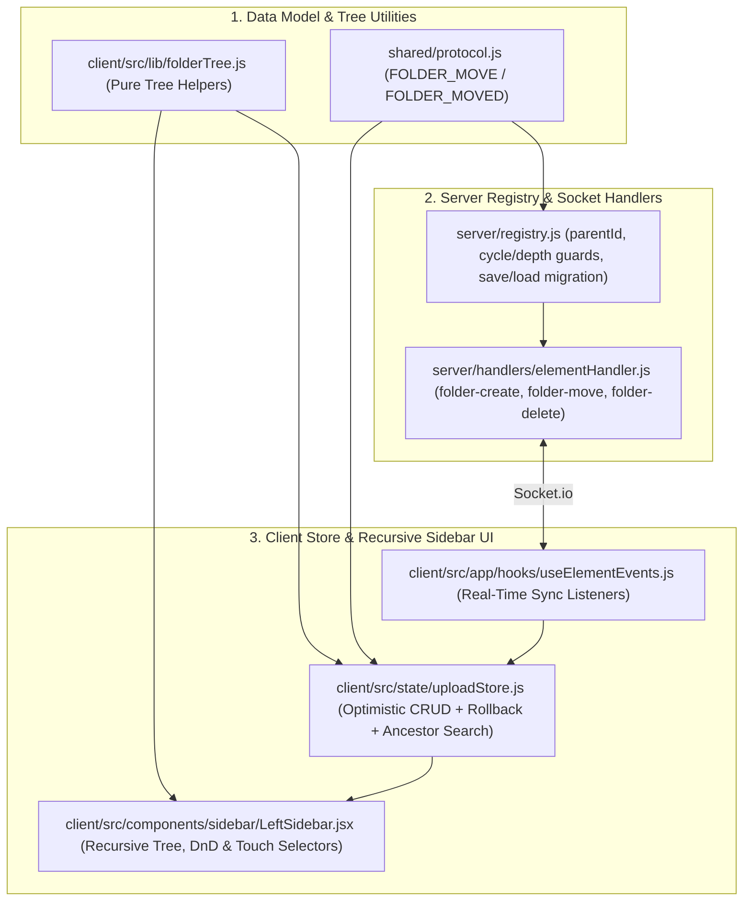

# Collaborative Image Folder Nesting — Implementation Plan

## 🎯 Executive Summary

Currently, the **Antigravity Canvas** image library supports a single flat level of folders (`Folder: { id, name }`, `Asset: { id, name, url, folderId }`). This plan scopes out the end-to-end architecture to support **hierarchical folder nesting (subfolders)** across the shared WebSocket protocol, server state registry, disk persistence, pure tree-math utilities, client upload store, and the Left Sidebar UI (both desktop drag-and-drop and mobile/touch selectors).

---

## 🔍 Blast Radius Analysis (Per `agent.md` §Guardrails 2)

| Layer | File | Scope | Callers / Events Affected |
| :--- | :--- | :--- | :--- |
| **Shared Protocol** | [shared/protocol.js](file:///c:/Users/Scott%20Simenel/.gemini/antigravity/scratch/realtime-canvas/shared/protocol.js) | Client & Server | Adds `FOLDER_MOVE` (`'folder-move'`) and `FOLDER_MOVED` (`'folder-moved'`); extends `FOLDER_CREATE` / `FOLDER_DELETE` payloads with `parentId`. |
| **Pure Tree Helpers** | `client/src/lib/folderTree.js` *(New)* | Client (Pure JS) | Imported by `uploadStore.js`, `LeftSidebar.jsx`, and unit-tested in `folderTree.test.js`. Zero DOM/React dependencies. |
| **Server State** | [server/registry.js](file:///c:/Users/Scott%20Simenel/.gemini/antigravity/scratch/realtime-canvas/server/registry.js) | Server (Room-wide) | `createFolder`, `deleteFolder`, new `moveFolder`, `saveState`, `loadState` (backward-compatible migration for legacy flat saves). |
| **Server Handlers** | [server/handlers/elementHandler.js](file:///c:/Users/Scott%20Simenel/.gemini/antigravity/scratch/realtime-canvas/server/handlers/elementHandler.js) | Server (Room-wide) | `EVENTS.FOLDER_CREATE`, `EVENTS.FOLDER_MOVE`, `EVENTS.FOLDER_DELETE`. |
| **Client Store** | [client/src/state/uploadStore.js](file:///c:/Users/Scott%20Simenel/.gemini/antigravity/scratch/realtime-canvas/client/src/state/uploadStore.js) | Client | `handleCreateFolder(name, parentId)`, `handleRenameFolder`, `handleDeleteFolder`, new `handleMoveFolder(folderId, parentId)`, `visibleAssets` / `hiddenAssets` ancestor search matching. |
| **Socket Listeners** | [client/src/app/hooks/useElementEvents.js](file:///c:/Users/Scott%20Simenel/.gemini/antigravity/scratch/realtime-canvas/client/src/app/hooks/useElementEvents.js) | Client | `onFolderCreated`, `onFolderMoved`, `onFolderDeleted`. |
| **Sidebar UI** | [client/src/components/sidebar/LeftSidebar.jsx](file:///c:/Users/Scott%20Simenel/.gemini/antigravity/scratch/realtime-canvas/client/src/components/sidebar/LeftSidebar.jsx) | Client | Recursive folder tree renderer, inline `"New Subfolder"` action, folder-on-folder & folder-to-root Drag-and-Drop, hierarchical path labels in mobile `<select>`. |
| **Architecture Map** | [STRUCTURE.md](file:///c:/Users/Scott%20Simenel/.gemini/antigravity/scratch/realtime-canvas/STRUCTURE.md) | Docs | Document `client/src/lib/folderTree.js`. |

---

## ⚠️ Key Design Decisions & Open Questions for Review

> [!IMPORTANT]
> Before implementation begins, please review the following architectural choices (feel free to confirm the defaults or request adjustments):
> 1. **Maximum Nesting Depth (`MAX_FOLDER_DEPTH = 5`)**: Because `LeftSidebar.jsx` is `320px` wide (`sm:w-80`), unbounded indentation would eventually squeeze the 2-column thumbnail grid. We propose capping nesting at **5 levels** (Root = depth 1 up to depth 5, with `10px` indentation per level).
> 2. **Folder Deletion Behavior (Promote Children to Parent vs. Cascade Delete Subfolders)**:
>    - **Proposed Default (Promote/Reparent)**: Deleting a folder `F` moves its direct subfolders and direct assets up one level into `F.parentId` (or `null` Root if `F` was a top-level folder). No subfolders or uploaded images are lost.
>    - **Alternative (Cascade Subtree)**: Deleting `F` deletes `F` and all descendant subfolders, while moving all assets in the entire subtree back to Root (`null`).
> 3. **Sibling-Scoped Duplicate Names**: Duplicate folder names will be checked **per parent folder** (`(f.parentId || null) === (parentId || null)`) rather than globally, so users can create e.g. `Act 1 / Maps` and `Act 2 / Maps`.

---

## 🛠️ Detailed Component-by-Component Plan

### Phase 1: Shared Protocol & Pure Tree Utilities

#### 1.1 `[MODIFY]` [shared/protocol.js](file:///c:/Users/Scott%20Simenel/.gemini/antigravity/scratch/realtime-canvas/shared/protocol.js)
- Add client-to-server event `FOLDER_MOVE: 'folder-move'` and server-to-client broadcast event `FOLDER_MOVED: 'folder-moved'`.
- Add JSDoc `@typedef` contracts for `FolderPayload` (`{ id: string, name: string, parentId: string | null }`) and `FolderMovePayload` (`{ folderId: string, parentId: string | null }`).

#### 1.2 `[NEW]` `client/src/lib/folderTree.js`
Per `agent.md` §1 (*Decouple Computation/Math Logic from Views*), all hierarchy traversal, cycle detection, depth calculation, and path formatting logic will live in a pure, zero-dependency utility module with full JSDoc contracts:
- `MAX_FOLDER_DEPTH = 5`: Constant defining maximum allowed folder depth (1-indexed: top-level folder is depth `1`, max depth is `5`).
- `getFolderDepth(folderId, folders)`: Returns the 1-indexed depth of `folderId` (`0` if `null`/root), using a `Set` of visited IDs to guard against malformed circular references.
- `getMaxSubtreeDepthOffset(folderId, folders)`: Returns the longest downward chain length beneath `folderId` (`0` if it has no child folders). Used when moving a folder with subfolders to verify `getFolderDepth(targetParentId) + 1 + getMaxSubtreeDepthOffset(folderId) <= MAX_FOLDER_DEPTH`.
- `isDescendantFolder(candidateId, targetAncestorId, folders)`: Returns `true` if `candidateId === targetAncestorId` or `targetAncestorId` is an ancestor of `candidateId`. Prevents moving a folder into itself or any of its descendants.
- `getAncestorFolderIds(folderId, folders)`: Returns an ordered array of ancestor folder IDs from root down to `folderId`'s parent (`[rootId, ..., parentId]`).
- `getDescendantFolderIds(folderId, folders)`: Returns all descendant folder IDs inside `folderId`'s subtree.
- `canMoveFolder(folderId, targetParentId, folders)`: Validates:
  1. `folderId` exists and `current.parentId !== targetParentId`.
  2. `!isDescendantFolder(targetParentId, folderId, folders)` (no cycles).
  3. Target depth + subtree height `<= MAX_FOLDER_DEPTH`.
  4. No sibling folder inside `targetParentId` already has the same case-insensitive `name`.
  Returns `{ valid: boolean, error?: string }`.
- `buildFolderTree(folders)`: Groups and sorts folders into a hierarchical tree `[ { ...folder, depth, pathLabel, children: [...] } ]` and a flat depth-first list (`flattenFolderTree`) for `<select>` dropdown rendering (e.g., `📁 Dungeons`, `  ↳ 📁 Crypts`).
- `getSubtreeAssetIds(folderId, folders, assets)`: Counts or collects all assets belonging to `folderId` or any of its descendant folders.

---

### Phase 2: Backend Registry, Validation & Persistence

#### 2.1 `[MODIFY]` [server/registry.js](file:///c:/Users/Scott%20Simenel/.gemini/antigravity/scratch/realtime-canvas/server/registry.js)
- **`createFolder(folder)`**:
  - Normalize `parentId`: verify `folder.parentId && this.folders.has(folder.parentId)` and depth `< MAX_FOLDER_DEPTH`, otherwise set `parentId = null`.
  - Save `{ id: folder.id, name: folder.name, parentId }`.
- **`moveFolder(folderId, parentId)`** *(New Method)*:
  - Lookup `folder = this.folders.get(folderId)`. Return `null` if not found.
  - Normalize `targetParentId = parentId || null`.
  - If `targetParentId !== null`:
    - Verify `this.folders.has(targetParentId)`.
    - Walk ancestor chain from `targetParentId` up to root to reject cycles (`curr === folderId`) and enforce `MAX_FOLDER_DEPTH`.
  - Set `folder.parentId = targetParentId` and return `folder`.
- **`deleteFolder(folderId)`**:
  - Lookup `folder = this.folders.get(folderId)`. Return `null` if not found.
  - Determine `fallbackParentId = folder.parentId || null` (if `fallbackParentId` is not in `this.folders`, use `null`).
  - Re-parent direct child folders (`child.parentId === folderId` $\rightarrow$ `child.parentId = fallbackParentId`).
  - Re-parent direct assets in `folderId` (`asset.folderId === folderId` $\rightarrow$ `asset.folderId = fallbackParentId`).
  - Delete `folderId` from `this.folders` and return `{ deletedFolderId: folderId, fallbackParentId }`.
- **`loadState(saveId)` (Backward-Compatible Save Migration)**:
  - Normalize each loaded folder with `parentId: folder.parentId || null`.
  - Second pass after populating `this.folders`: if any folder's `parentId` references a missing folder ID or forms a cycle, reset its `parentId` to `null`.

#### 2.2 `[MODIFY]` [server/handlers/elementHandler.js](file:///c:/Users/Scott%20Simenel/.gemini/antigravity/scratch/realtime-canvas/server/handlers/elementHandler.js)
- **`EVENTS.FOLDER_CREATE`**: Pass `parentId: folder.parentId || null` into `registry.createFolder(folder)` and broadcast `EVENTS.FOLDER_CREATED`.
- **`EVENTS.FOLDER_MOVE`** *(New Handler)*:
  - Validate `{ folderId, parentId }`.
  - Call `registry.moveFolder(folderId, parentId || null)`.
  - If rejected (`null`), invoke `callback({ success: false, error: 'Invalid folder move' })`.
  - Otherwise broadcast `EVENTS.FOLDER_MOVED` (`{ folder: updatedFolder, userId: socket.id }`) to the room and invoke `callback({ success: true, folder: updatedFolder })`.
- **`EVENTS.FOLDER_DELETE`**:
  - Call `registry.deleteFolder(folderId)`.
  - Broadcast `EVENTS.FOLDER_DELETED` (`{ folderId, fallbackParentId: res.fallbackParentId, userId: socket.id }`) and return `{ success: true, folderId, fallbackParentId: res.fallbackParentId }`.

---

### Phase 3: Client State Store & Real-Time Event Listeners

#### 3.1 `[MODIFY]` [client/src/state/uploadStore.js](file:///c:/Users/Scott%20Simenel/.gemini/antigravity/scratch/realtime-canvas/client/src/state/uploadStore.js)
- **`handleCreateFolder(name, parentId = null)`**:
  - Normalize `targetParentId = parentId || null`.
  - Check sibling duplicate name: `folders.some(f => (f.parentId || null) === targetParentId && f.name.toLowerCase() === trimmed.toLowerCase())`.
  - Check depth limit via `getFolderDepth(targetParentId, folders) >= MAX_FOLDER_DEPTH`.
  - Perform **optimistic update** with **rollback** on `res?.success === false` (per `agent.md` §3 `[BLOCKING]`).
- **`handleRenameFolder(folderId, name)`**:
  - Scope duplicate name check to siblings sharing `(f.parentId || null) === (current.parentId || null)`.
  - Perform optimistic rename with rollback on failed socket ACK.
- **`handleMoveFolder(folderId, targetParentId = null)`** *(New Action)*:
  - Validate using `canMoveFolder(folderId, targetParentId, folders)`. If invalid, set `uploadError(check.error)` and abort.
  - Perform optimistic update (`f.parentId = targetParentId || null`) and emit `EVENTS.FOLDER_MOVE`, rolling back to previous `folders` snapshot if `res?.success === false`.
- **`handleDeleteFolder(folderId)`**:
  - Compute `fallbackParentId = targetFolder?.parentId || null`.
  - Optimistically remove `folderId`, re-parent direct child folders (`f.parentId === folderId` $\rightarrow$ `fallbackParentId`), and re-parent direct assets (`a.folderId === folderId` $\rightarrow$ `fallbackParentId`), with full state rollback if `res?.success === false`.
- **Enhanced Ancestor-Aware Search (`visibleAssets` & `hiddenAssets`)**:
  - When `searchQuery` is active, an asset matches if its own `name` matches **OR** its immediate folder or **any ancestor folder** (`getAncestorFolderIds`) matches `query`.

#### 3.2 `[MODIFY]` [client/src/app/hooks/useElementEvents.js](file:///c:/Users/Scott%20Simenel/.gemini/antigravity/scratch/realtime-canvas/client/src/app/hooks/useElementEvents.js)
- Add `onFolderMoved = ({ folder }) => setFolders(prev => prev.map(f => f.id === folder.id ? folder : f))` and subscribe/unsubscribe to `EVENTS.FOLDER_MOVED`.
- Update `onFolderDeleted = ({ folderId, fallbackParentId = null }) => ...` so both child folders (`f.parentId === folderId`) and assets (`a.folderId === folderId`) update to `fallbackParentId`.

---

### Phase 4: Recursive LeftSidebar UI, Drag-and-Drop & Touch Controls

#### 4.1 `[MODIFY]` [client/src/components/sidebar/LeftSidebar.jsx](file:///c:/Users/Scott%20Simenel/.gemini/antigravity/scratch/realtime-canvas/client/src/components/sidebar/LeftSidebar.jsx)
1. **Recursive Folder Node Renderer (`renderFolderNode(folder, depth)`)**:
   - Replaces the flat `folders.map(...)` loop with a recursive renderer starting from top-level folders (`folderTree`).
   - **Visual Nesting**: Nested folders (`depth > 0`) render inside their expanded parent container with a clean tree guide (`ml-2.5 pl-2 border-l border-slate-800/80`).
   - **Badge Count**: Displays direct + nested asset count (e.g. `(3)` when all are direct, or `(2 · 5 total)` / total subtree count when collapsed) so parent folders with only subfolders don't look empty.
2. **Inline Subfolder Creation (`📁+` Button on Folder Header)**:
   - Each folder header whose depth is `< MAX_FOLDER_DEPTH` includes a `"New Subfolder"` (`+`) icon button next to Rename and Delete.
   - Clicking it sets `creatingSubfolderParentId = folder.id`, expands the parent folder, and displays a compact inline input inside the parent folder to create a child folder directly under `folder.id`.
3. **Folder-on-Folder & Folder-to-Root Drag-and-Drop**:
   - Folder headers are `draggable={editingFolderId !== folder.id}`, emitting payload `{ type: 'folder', folderId: folder.id, sourceParentId: folder.parentId || null }`.
   - `handleDragOverFolder` / `handleDropOnFolder` call `e.stopPropagation()` so dragging over a nested child folder highlights **only** that child folder, not its parent container.
   - Dropping a `{ type: 'folder' }` payload onto a target folder validates `canMoveFolder` and calls `handleMoveFolder(data.folderId, targetFolder.id)`, auto-expanding the target folder.
   - Dropping a nested folder (`sourceParentId !== null`) onto the `"Drop here to move back to Root Library"` zone calls `handleMoveFolder(data.folderId, null)`.
4. **Search Auto-Expansion Across Ancestors**:
   - When `searchQuery` is non-empty, a folder is visible if its own name matches, or if any asset or subfolder in its subtree matches. All matching ancestor folders automatically expand during active search.
5. **Touch / Mobile `<select>` Path Labels**:
   - Uses `flattenFolderTree(folders)` so the asset card's "Move to folder" `<select>` displays indented hierarchical paths (e.g. `📁 Dungeons`, `↳ 📁 Crypts`, `  ↳ 📁 Boss Room`).

---

## 🧪 Verification & Testing Plan

1. **Unit Tests (`vitest run`)**:
   - **`[NEW]` `client/src/lib/__tests/folderTree.test.js`**:
     - Test `getFolderDepth`, `getMaxSubtreeDepthOffset`, `isDescendantFolder` (including cycle protection), `getAncestorFolderIds`, `getDescendantFolderIds`, `canMoveFolder` (self-move, cycle move, max depth exceeded, sibling duplicate name), and `buildFolderTree` / `flattenFolderTree`.
   - **`[MODIFY]` [client/src/state/__tests/uploadStore.test.js](file:///c:/Users/Scott%20Simenel/.gemini/antigravity/scratch/realtime-canvas/client/src/state/__tests/uploadStore.test.js)**:
     - Test creating nested subfolders (`handleCreateFolder('Sub', parentId)`).
     - Test sibling-scoped duplicate name validation (same name allowed in different parents, blocked in same parent).
     - Test `handleMoveFolder` (valid move, cycle rejection, max-depth rejection, optimistic rollback on failure).
     - Test `handleDeleteFolder` reparenting child folders and assets to `fallbackParentId`.
     - Test ancestor folder search matching (searching top-level folder name returns assets in nested grandchild folders).
   - **`[MODIFY]` [server/__tests__/roomManager.test.js](file:///c:/Users/Scott%20Simenel/.gemini/antigravity/scratch/realtime-canvas/server/__tests__/roomManager.test.js)**:
     - Test server `CanvasRegistry` nested folder creation, `moveFolder` cycle prevention, `deleteFolder` reparenting, and `saveState`/`loadState` persistence of `parentId`.
2. **Verification Loop (`agent.md` §Workflows 3 `[BLOCKING]`)**:
   - `npm --prefix client run lint` (0 errors, 0 warnings)
   - `npm --prefix client run test -- --coverage --run`
   - `node --test server/__tests__/roomManager.test.js`
   - `npm --prefix client run build`
   - `node --check server/server.js`
