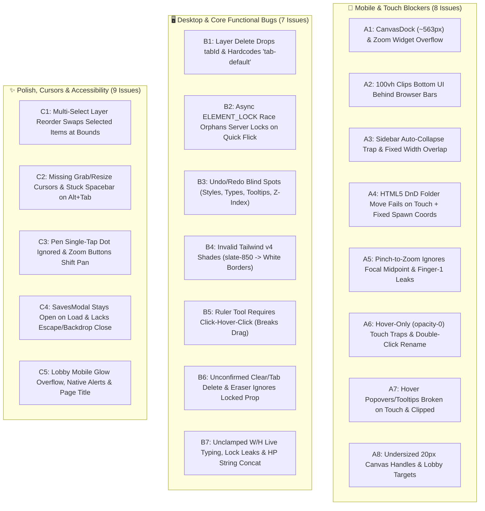

# Desktop & Mobile UX Audit & Remediation Plan

## 🎯 Executive Summary

We performed a comprehensive usability, responsive layout, touch interaction, and functional audit across the entire **Antigravity Canvas** client (`client/src/`). While the core real-time architecture and recent multi-room/folder features are solid, the audit uncovered **24 concrete issues** spanning mobile/touch blockers, desktop interaction bugs, CSS regressions, and collaborative state edge cases.

---

## 📱 Category A: Mobile & Touch Usability Issues

### A1. `[Critical]` `CanvasDock` Overflows Smartphone Viewports & Collides with Zoom Controls
* **Locations**: [CanvasDock.jsx](file:///c:/Users/Scott%20Simenel/.gemini/antigravity/scratch/realtime-canvas/client/src/components/canvas/CanvasDock.jsx#L26-L98), [Canvas.jsx](file:///c:/Users/Scott%20Simenel/.gemini/antigravity/scratch/realtime-canvas/client/src/components/canvas/Canvas.jsx#L1730-L1768)
* **Issue**:
  1. `CanvasDock` uses `fixed bottom-6 left-1/2 -translate-x-1/2 w-max` with 11 buttons + 3 dividers totaling **`~563px`**. On mobile phones (`320px–430px`), **70px–120px is clipped off both sides of the screen**, making the **Select** and **Pan** tools on the left and the **Inspector** and **Zen Mode** toggles on the right completely unreachable.
  2. The Pen sub-toolbar (`line 29`, `~360px` wide) also overflows narrow screens.
  3. On viewports `< 880px`, the centered `CanvasDock` directly overlaps the bottom-right Zoom pill (`absolute bottom-4 right-4` in `Canvas.jsx:1732`).
* **Remediation**: Constrain `CanvasDock` and its sub-toolbars with `max-w-[calc(100vw-1rem)] overflow-x-auto no-scrollbar` (or compact spacing on `<640px`), and reposition the Zoom pill above the dock on narrow viewports (`bottom-20 sm:bottom-4`).

### A2. `[Critical]` `100vh` Clips Bottom Controls Behind Mobile Browser Toolbars
* **Locations**: [index.css](file:///c:/Users/Scott%20Simenel/.gemini/antigravity/scratch/realtime-canvas/client/src/index.css#L27-L35), [index.html](file:///c:/Users/Scott%20Simenel/.gemini/antigravity/scratch/realtime-canvas/client/index.html#L6-L7), [AppContent.jsx](file:///c:/Users/Scott%20Simenel/.gemini/antigravity/scratch/realtime-canvas/client/src/app/AppContent.jsx#L280)
* **Issue**: `#root` uses `height: 100vh` with `overflow: hidden`. On iOS Safari and Android Chrome, `100vh` includes the area covered by the dynamic browser address/navigation bars, clipping the bottom ~50–80px (`CanvasDock` and zoom controls). Additionally, `<main className="p-5">` (`AppContent.jsx:338`) wastes `40px` of horizontal and vertical space on small screens.
* **Remediation**: Use `height: 100dvh` (with `100vh` fallback) on `#root` and `AppContent`, add `viewport-fit=cover` in `index.html`, respect `env(safe-area-inset-bottom)` on bottom-fixed bars, and reduce `<main>` padding to `p-1.5 sm:p-5` on mobile.

### A3. `[Critical]` Sidebar Auto-Collapse Trap (`leftPanelCollapsed`) & Mobile Sidebar Overlap
* **Locations**: [uiStore.js](file:///c:/Users/Scott%20Simenel/.gemini/antigravity/scratch/realtime-canvas/client/src/state/uiStore.js#L46-L58), [LeftSidebar.jsx](file:///c:/Users/Scott%20Simenel/.gemini/antigravity/scratch/realtime-canvas/client/src/components/sidebar/LeftSidebar.jsx#L350-L362), [RightSidebar.jsx](file:///c:/Users/Scott%20Simenel/.gemini/antigravity/scratch/realtime-canvas/client/src/components/sidebar/RightSidebar.jsx#L411-L423), [CanvasDock.jsx](file:///c:/Users/Scott%20Simenel/.gemini/antigravity/scratch/realtime-canvas/client/src/components/canvas/CanvasDock.jsx#L206-L242)
* **Issue**:
  1. `handleCanvasInteraction` in `uiStore.js:56-58` ignores its parameter and sets `setLeftPanelCollapsed(true)` on every canvas click/tap.
  2. When `leftPanelCollapsed` is `true`, `LeftSidebar.jsx:355` applies `-translate-x-[calc(100%+12px)]`, moving the `320px` sidebar at `left-6` (`24px`) to `x = -308px` (**completely off-screen**, hiding even its `w-1.5` collapse strip!).
  3. Un-collapsing relies solely on `onMouseEnter` (`LeftSidebar.jsx:357`), which cannot fire on touch devices (nor on desktop when translated `-8px` past the viewport edge). Because `showLeftSidebar` remains `true`, the Library dock button stays highlighted blue and requires a **double-tap** to reopen.
  4. Both sidebars have fixed `w-80` (`320px`) + `24px` margin (`344px`), overflowing `320px` screens, and opening both on mobile (or exiting Zen Mode in `uiStore.js:50-51`, which forces both `true`) stacks them on top of each other.
* **Remediation**:
  - Replace the broken off-screen `leftPanelCollapsed`/`rightPanelCollapsed` hover-edge mechanic: on mobile (`<1024px`), close `showLeftSidebar` cleanly when interacting with the canvas and enforce mutual exclusion so opening `LeftSidebar` on mobile closes `RightSidebar` (and vice versa).
  - Keep the dock button state strictly in sync (`showLeftSidebar && !leftPanelCollapsed`), or if collapsed on desktop, keep a visible clickable tab handle inside the viewport (`-translate-x-[calc(100%-12px)]`) with an `onClick` toggle.
  - Make sidebar widths responsive: `left-3 right-3 w-auto sm:left-6 sm:right-auto sm:w-80` (and vice versa for `RightSidebar`).
  - Fix `handleToggleZenMode` in `uiStore.js` so exiting Zen Mode on `<1024px` does not force both sidebars open simultaneously.

### A4. `[Critical]` HTML5 Drag-and-Drop (`draggable="true"`) Has No Mobile Fallback & Tap-Spawn Ignores Viewport
* **Locations**: [LeftSidebar.jsx](file:///c:/Users/Scott%20Simenel/.gemini/antigravity/scratch/realtime-canvas/client/src/components/sidebar/LeftSidebar.jsx#L118-L325), [useElementActions.js](file:///c:/Users/Scott%20Simenel/.gemini/antigravity/scratch/realtime-canvas/client/src/app/hooks/useElementActions.js#L24-L86)
* **Issue**:
  1. Mobile browsers (iOS Safari, Android Chrome) do not trigger HTML5 `onDragStart`/`onDrop`. Moving uploaded images into or out of folders in `LeftSidebar.jsx` relies 100% on HTML5 DnD, leaving mobile users with **no way to organize assets into folders**.
  2. Tapping an asset card or clicking "Spawn Shape" calls `handleSpawnImage` / `handleSpawnShape` without coordinates, which spawns elements at hardcoded `120 + Math.random() * 200` (`useElementActions.js:33, 83`) instead of the center of the user's current panned/zoomed viewport.
* **Remediation**:
  - Add a compact "Move to Folder" button/select menu on uploaded asset cards so both mobile and desktop users can move assets into/out of folders without dragging.
  - Compute the center of the active viewport (`( -panOffset.x / scale ) + virtualWidth / 2`, etc.) when spawning shapes or images via click/tap.

### A5. `[Critical]` Pinch-to-Zoom Ignores Focal Point & Finger-1 Triggers Premature Eraser/Select Actions
* **Locations**: [Canvas.jsx](file:///c:/Users/Scott%20Simenel/.gemini/antigravity/scratch/realtime-canvas/client/src/components/canvas/Canvas.jsx#L484-L565)
* **Issue**:
  1. **Focal Point Drift**: In `handlePointerMove` (`lines 550-564`), pinch-to-zoom updates `userZoom` and adds `dx, dy` (`newMidpoint - start.midpoint`) to `start.panOffset`, without compensating for how changing `scale` shifts the virtual coordinates under the pinch midpoint. Elements away from the canvas center fly out from under the user's fingers during a pinch.
  2. **Finger-1 Premature Action**: When pinching with 2 fingers, Finger 1 touches down a few milliseconds before Finger 2 (`activePointerIds.length === 1` at `line 521`), immediately running `handleMouseDown`. If `activeTool === 'eraser'`, Finger 1 immediately deletes/splits paths and emits `ELEMENT_DELETE` to the server before Finger 2 touches down!
* **Remediation**:
  - Update pinch-to-zoom math in `Canvas.jsx` (and extract a pure helper into `CanvasSelection.js` per `agent.md` §1) so the virtual point under `start.midpoint` stays anchored at `newMidpoint` as `nextZoom` changes.
  - For touch inputs (`e.pointerType === 'touch'`), defer destructive Finger-1 `pointerdown` actions (such as Eraser hit-deletion or Measure reset) until first movement beyond a small threshold or after confirming a second finger hasn't touched down within ~50ms.

### A6. `[High]` Invisible Hover-Only Touch Traps (`opacity-0 group-hover:opacity-100`), Unreachable Mobile Profile Rename & Header Overflow
* **Locations**: [LeftSidebar.jsx](file:///c:/Users/Scott%20Simenel/.gemini/antigravity/scratch/realtime-canvas/client/src/components/sidebar/LeftSidebar.jsx#L265-L323), [TabButton.jsx](file:///c:/Users/Scott%20Simenel/.gemini/antigravity/scratch/realtime-canvas/client/src/components/common/TabButton.jsx#L34-L85), [Header.jsx](file:///c:/Users/Scott%20Simenel/.gemini/antigravity/scratch/realtime-canvas/client/src/components/header/Header.jsx#L38-L225)
* **Issue**:
  1. **Asset Card Touch Traps (`LeftSidebar.jsx:265-323`)**: Four overlay buttons (Rename, Set Background, Hide, Delete) use `opacity-0 group-hover:opacity-100` while keeping pointer events active. On touch screens, tapping a thumbnail to spawn an image accidentally hits these invisible buttons and triggers Delete/Hide/Background! Also, when an image is actively set as the room background (`line 283`), its sky-blue indicator stays hidden at `opacity-0` unless hovered.
  2. **Tab Rename & Delete (`TabButton.jsx:36, 80`)**: Tab renaming only binds `onDoubleClick` (unreliable/broken on mobile touch), and the `✕` delete button uses `opacity-0 group-hover:opacity-100` (invisible yet clickable on touch, even when `isActive` is true).
  3. **Header Overflow & Hidden Profile (`Header.jsx:86, 101, 111, 215-220`)**: Undo, Redo, and Saves never hide their text labels on `<640px`, causing the header to overflow `<520px` screens. Meanwhile, inside the user profile pill (`lines 215-220`), both `currentUser.name` and `✏️` have `hidden sm:inline`, collapsing the rename target to `0×0px` on mobile.
* **Remediation**:
  - Make overlay controls visible on touch/mobile (`opacity-100 sm:opacity-0 sm:group-hover:opacity-100` or `pointer-events-none group-hover:pointer-events-auto` when hidden), and always show the background indicator when active.
  - On `TabButton`, show both a small rename `✏️` trigger and the `✕` delete button when `isActive` is true (with `pointer-events-none` when `opacity-0`).
  - In `Header.jsx`, hide Undo/Redo/Saves text labels below `md:` (`hidden md:inline`), allow tapping the profile pill on mobile to edit the username, and enlarge the cursor color picker target.

### A7. `[High]` Hover-Only Popovers & Tooltips Broken on Touch & Clipped/Misaligned on Desktop
* **Locations**: [Canvas.jsx](file:///c:/Users/Scott%20Simenel/.gemini/antigravity/scratch/realtime-canvas/client/src/components/canvas/Canvas.jsx#L468-L470), [ActiveRollsIndicator.jsx](file:///c:/Users/Scott%20Simenel/.gemini/antigravity/scratch/realtime-canvas/client/src/components/dice/ActiveRollsIndicator.jsx#L183-L190), [DiceRollerWidget.jsx](file:///c:/Users/Scott%20Simenel/.gemini/antigravity/scratch/realtime-canvas/client/src/components/sidebar/DiceRollerWidget.jsx#L257-L261), [Header.jsx](file:///c:/Users/Scott%20Simenel/.gemini/antigravity/scratch/realtime-canvas/client/src/components/header/Header.jsx#L140-L165)
* **Issue**:
  1. **Canvas Tooltips (`Canvas.jsx:468, 1551-1676`)**: `handlePointerDown` immediately clears `hoveredElementId`, so touch users can **never** see element tooltips (HP bars, stats, titles). On desktop, `tooltipLeft = screenCx` (`w-64` = `256px`) is not clamped horizontally, clipping tooltips near the left/right edges of the canvas. Also, the `'i'` badge in `CanvasRenderer.js:354-373` rotates upside-down when an element is rotated.
  2. **`ActiveRollsIndicator` Popover (`ActiveRollsIndicator.jsx:187`)**: Hardcoded to `right: '336px'` (written when the dice roller lived in the right sidebar). Because `DiceRollerWidget` is now centered at the bottom, the popover spawns in empty space on desktop, goes completely off-screen (`336px + 320px = 656px`) on mobile, and gets permanently stuck when closing the dice roller or clearing history because `hoveredRoll` is never reset!
  3. **Header Online Users Popover (`Header.jsx:140-165`)**: Uses only `onMouseEnter`/`onMouseLeave` (no `onClick` for touch) and has an 8px vertical gap between the badge and `top-9` popover that causes `onMouseLeave` to fire when moving the cursor into the popover.
* **Remediation**:
  - Show the canvas tooltip for a single-selected element when not actively dragging (`hoveredElementId || (selectedElementIds.length === 1 && !isDragging ? selectedElementIds[0] : null)`), clamp `tooltipLeft` to `[136, canvasSize.width - 136]`, and counter-rotate the `'i'` glyph in `CanvasRenderer.js`.
  - Anchor `ActiveRollsIndicator` popover responsively (`left-1/2 -translate-x-1/2 bottom-28 sm:left-auto sm:translate-x-0 sm:right-6`), clear `hoveredRoll` when `showDiceRoller` closes or `rollHistory` clears, and support tap-to-toggle on mobile.
  - Add `onClick` toggle + outside-click dismissal + a continuous hover bridge (`pt-2` wrapper instead of `top-9` gap) to the Header Online Users popover.

### A8. `[High]` Undersized Touch Targets on Canvas Handles & Lobby Controls
* **Locations**: [CanvasSelection.js](file:///c:/Users/Scott%20Simenel/.gemini/antigravity/scratch/realtime-canvas/client/src/components/canvas/CanvasSelection.js#L22-L43), [CanvasRenderer.js](file:///c:/Users/Scott%20Simenel/.gemini/antigravity/scratch/realtime-canvas/client/src/components/canvas/CanvasRenderer.js#L450-L472), [Lobby.jsx](file:///c:/Users/Scott%20Simenel/.gemini/antigravity/scratch/realtime-canvas/client/src/components/lobby/Lobby.jsx#L261-L315)
* **Issue**: Resize/rotate handles use a hit radius of `10 / scale` (`20×20px` screen diameter), causing touch users to miss the handles and deselect the element instead. Lobby color swatches (`w-6 h-6`) and randomizer buttons are also `<28px`.
* **Remediation**: Increase handle hit-test radius in `CanvasSelection.js` (e.g., `18 / scale` or touch-aware radius) and slightly enlarge visual handle rendering, and increase Lobby button/swatch hit areas.

---

## 🖥️ Category B: Desktop & Cross-Platform Functional Bugs

### B1. `[Critical]` RightSidebar Layer Delete Omits `tabId` & Hardcodes `'tab-default'`
* **Location**: [RightSidebar.jsx](file:///c:/Users/Scott%20Simenel/.gemini/antigravity/scratch/realtime-canvas/client/src/components/sidebar/RightSidebar.jsx#L379-L390)
* **Issue**: Clicking `🗑️ Delete Element` in the Layers panel emits `socket.emit(EVENTS.ELEMENT_DELETE, { elementId: el.id })` without `tabId: activeTabId` (`RightSidebar.jsx` does not even destructure `activeTabId` from its props!) and pushes `tabId: 'tab-default'` to `historyStore`. On any secondary tab, the server fails to delete the element from the active tab, and pressing `Ctrl+Z` switches to `tab-default` and duplicates the element there!
* **Remediation**: Destructure `activeTabId` in `RightSidebar.jsx` (or route deletion through `handleDeleteSelected` / pass `{ elementIds: [el.id], tabId: activeTabId }`) and record `tabId: activeTabId` in `pushAction`.

### B2. `[High]` Async `ELEMENT_LOCK` Race Condition Orphans Server Locks & Drops Fast Drag Updates
* **Location**: [Canvas.jsx](file:///c:/Users/Scott%20Simenel/.gemini/antigravity/scratch/realtime-canvas/client/src/components/canvas/Canvas.jsx#L880-L889) (and `lines 960-971, 1303-1317, 1487-1512`)
* **Issue**: Single-element drag/resize/rotate sets `dragStateRef.current.hasLock = false` until the server's `ELEMENT_LOCK` callback returns, and skips emitting `ELEMENT_UPDATE` during `handleMouseMove` while `hasLock` is `false`. If a user performs a fast flick and releases the pointer (`handleMouseUp`) **before** the `ELEMENT_LOCK` ACK arrives:
  1. Zero `ELEMENT_UPDATE` events are ever sent to the server (desyncing the element position across clients).
  2. `handleMouseUp` sets `dragStateRef.current = null` without unlocking (since `hasLock` was `false`).
  3. When the `ELEMENT_LOCK` ACK arrives moments later, `dragStateRef.current` is `null`, so `ELEMENT_UNLOCK` is **never emitted**, leaving the element permanently locked on the server!
* **Remediation**:
  - In the `ELEMENT_LOCK` callback (`lines 882, 962`), if `dragStateRef.current` is already `null` (or no longer targeting `elId`) when `res?.success` arrives, immediately emit `ELEMENT_UPDATE` with the latest local element state followed by `ELEMENT_UNLOCK`.
  - In `handleMouseUp`, if a single-element transform occurred while `hasLock` was already `true`, also emit a final `ELEMENT_UPDATE` before `ELEMENT_UNLOCK` so the final resting coordinates are guaranteed to be synced.

### B3. `[High]` Undo/Redo (`historyStore`) Blind Spots & Z-Order Loss
* **Locations**: [useSelectionActions.js](file:///c:/Users/Scott%20Simenel/.gemini/antigravity/scratch/realtime-canvas/client/src/app/hooks/useSelectionActions.js#L64-L184), [historyStore.js](file:///c:/Users/Scott%20Simenel/.gemini/antigravity/scratch/realtime-canvas/client/src/state/historyStore.js#L64-L146), [InspectorWidget.jsx](file:///c:/Users/Scott%20Simenel/.gemini/antigravity/scratch/realtime-canvas/client/src/components/sidebar/InspectorWidget.jsx#L205-L501), [TooltipInspector.jsx](file:///c:/Users/Scott%20Simenel/.gemini/antigravity/scratch/realtime-canvas/client/src/components/sidebar/TooltipInspector.jsx#L23-L118)
* **Issue**:
  1. Changing Fill Color, Opacity, Outline settings, Shape Type, Snap-to-Grid, Lock state, or any Tooltip/HP/Stat field in `InspectorWidget` and `TooltipInspector` calls `handleInspectorChange` without recording an action in `historyStore`.
  2. `handleEndInspectorTransform` in `useSelectionActions.js:85-95` only checks `x, y, width, height, rotation`, ignoring `type` and `properties` changes.
  3. `historyStore.js:83-94, 240-251` omits `type: el.type` when undoing/redoing `'transform'` actions.
* **Remediation**:
  - Extend `handleEndInspectorTransform` and `historyStore` `'transform'` handling to compare and restore `type` and `properties` alongside geometry.
  - Record undoable `'transform'` actions for discrete inspector property toggles/changes (shape type, snap-to-grid, outline toggle, color/opacity commits, tooltip commits).

### B4. `[High]` Non-Existent Tailwind v4 Color Shades (`slate-850`, `indigo-650`, `rose-455`, etc.)
* **Locations**: [index.css](file:///c:/Users/Scott%20Simenel/.gemini/antigravity/scratch/realtime-canvas/client/src/index.css#L1), [LeftSidebar.jsx](file:///c:/Users/Scott%20Simenel/.gemini/antigravity/scratch/realtime-canvas/client/src/components/sidebar/LeftSidebar.jsx#L350), [RightSidebar.jsx](file:///c:/Users/Scott%20Simenel/.gemini/antigravity/scratch/realtime-canvas/client/src/components/sidebar/RightSidebar.jsx#L411), [CanvasDock.jsx](file:///c:/Users/Scott%20Simenel/.gemini/antigravity/scratch/realtime-canvas/client/src/components/canvas/CanvasDock.jsx#L223), [InspectorWidget.jsx](file:///c:/Users/Scott%20Simenel/.gemini/antigravity/scratch/realtime-canvas/client/src/components/sidebar/InspectorWidget.jsx#L512), [DiceRollerWidget.jsx](file:///c:/Users/Scott%20Simenel/.gemini/antigravity/scratch/realtime-canvas/client/src/components/sidebar/DiceRollerWidget.jsx#L143), [SavesModal.jsx](file:///c:/Users/Scott%20Simenel/.gemini/antigravity/scratch/realtime-canvas/client/src/components/saves/SavesModal.jsx#L99), [Header.jsx](file:///c:/Users/Scott%20Simenel/.gemini/antigravity/scratch/realtime-canvas/client/src/components/header/Header.jsx#L80)
* **Issue**: Custom intermediate Tailwind shades (`slate-205`, `slate-350`, `slate-355`, `slate-405`, `slate-450`, `slate-455`, `slate-550`, `slate-650`, `slate-750`, `slate-850`, `slate-905`, `indigo-205`, `indigo-650`, `rose-350`, `rose-455`, `sky-350`) are used throughout the components without being defined in `@theme` in `index.css`. In Tailwind v4, undefined color classes generate no CSS:
  - `border border-slate-850` renders a **1px solid white (`currentColor`) border** around `LeftSidebar`, `RightSidebar`, `
` dividers, and `SavesModal` rows!
  - `bg-indigo-650` on the active Dice button in `CanvasDock` renders transparent.
  - `text-rose-455` on "Delete Selected" and "Reset Bag" renders white instead of rose/red.
* **Remediation**: Define these intermediate custom palette tokens cleanly inside an `@theme` block in `client/src/index.css` (and replace `duration-205` with `duration-200`), immediately fixing every border, background, and text shade across all components.

### B5. `[High]` Measurement Ruler Tool (`measure`) Doesn't Support Drag-to-Measure
* **Location**: [Canvas.jsx](file:///c:/Users/Scott%20Simenel/.gemini/antigravity/scratch/realtime-canvas/client/src/components/canvas/Canvas.jsx#L598-L611) (and `lines 721-743`)
* **Issue**: The Ruler tool requires Click #1 -> unpressed hover movement -> Click #2 to establish a measurement. On touch devices (where hover doesn't exist) or when a desktop user clicks and drags, releasing the pointer (`pointerup`) leaves `isEstablished: false`, breaking touch measurement and confusing desktop users.
* **Remediation**: Support both workflows seamlessly: if the user drags the pointer a meaningful distance (`> 5px`) while holding down and releases (`pointerup`), set `isEstablished: true` automatically; if they simply click without dragging (`<= 5px`), preserve the existing Click #1 -> Hover -> Click #2 workflow.

### B6. `[High]` Unconfirmed Destructive Actions & Eraser/Clear Drawings Ignore `el.properties.locked`
* **Locations**: [useSelectionActions.js](file:///c:/Users/Scott%20Simenel/.gemini/antigravity/scratch/realtime-canvas/client/src/app/hooks/useSelectionActions.js#L225-L266), [Canvas.jsx](file:///c:/Users/Scott%20Simenel/.gemini/antigravity/scratch/realtime-canvas/client/src/components/canvas/Canvas.jsx#L778-L781) (and `lines 1019-1022`), [CanvasDock.jsx](file:///c:/Users/Scott%20Simenel/.gemini/antigravity/scratch/realtime-canvas/client/src/components/canvas/CanvasDock.jsx#L189-L198), [useTabs.js](file:///c:/Users/Scott%20Simenel/.gemini/antigravity/scratch/realtime-canvas/client/src/app/hooks/useTabs.js#L53-L75)
* **Issue**:
  1. Both `handleClearDrawings` (`useSelectionActions.js:234`) and the Eraser tool (`Canvas.jsx:778, 1019`) check transient drag locks (`locks[id]`) but **fail to check `el.properties?.locked`**, allowing locked drawings to be erased!
  2. Clicking "Clear All Drawings" in `CanvasDock` or clicking `✕` on a canvas tab immediately wipes out drawings or an entire tab for all connected users without confirmation.
* **Remediation**:
  - Guard `handleClearDrawings` and the Eraser tool in `Canvas.jsx` with `!el.properties?.locked`.
  - Add confirmation safeguards before clearing all drawings or deleting a populated tab, and fix `useTabs.js:39` to generate unique tab names (`Canvas N`) when earlier tabs have been deleted.

### B7. `[High]` Inspector Unclamped Live Typing, Lock Leaks, & HP Tracker String Concatenation
* **Locations**: [InspectorWidget.jsx](file:///c:/Users/Scott%20Simenel/.gemini/antigravity/scratch/realtime-canvas/client/src/components/sidebar/InspectorWidget.jsx#L52-L140), [TooltipInspector.jsx](file:///c:/Users/Scott%20Simenel/.gemini/antigravity/scratch/realtime-canvas/client/src/components/sidebar/TooltipInspector.jsx#L75-L92) (and `lines 183-217`), [useSelectionActions.js](file:///c:/Users/Scott%20Simenel/.gemini/antigravity/scratch/realtime-canvas/client/src/app/hooks/useSelectionActions.js#L33-L109)
* **Issue**:
  1. Typing `150` into Width or Height in `InspectorWidget.jsx` immediately broadcasts `width: 1` on the first keystroke (or `0` / negative values), collapsing the element on all users' canvases while typing.
  2. `handleEndInspectorTransform` unlocks `selectedElementIds` instead of the IDs locked in `originalInspectorElementsRef.current`, and range sliders only bind `onMouseUp`/`onTouchEnd` (which fail to fire if the pointer is released outside the slider or if the component unmounts), leaking element locks and leaving `isInspectorFocused` stuck `true`.
  3. In `TooltipInspector.jsx:86-88`, if a tracker's `value` is temporarily `''` (empty string) and the user clicks `Heal (+)`, `'' + adjustVal` concatenates a string (`"5"`), and negative numbers in the Quick Adjust input bypass `Math.min(max, ...)`.
* **Remediation**:
  - Clamp live Width/Height broadcasts to `[10, 2000]` (while allowing the local input text `dimensionInputs` to be edited naturally and clamped on blur/Enter).
  - Unlock all IDs recorded in `originalInspectorElementsRef.current` in `handleEndInspectorTransform`, and add `onBlur` / `onPointerUp` / unmount cleanup for inspector locks.
  - Coerce `Number(tracker.value) || 0` and `Math.abs(parseInt(..., 10))` in `TooltipInspector.jsx`, and allow pressing `Enter` to commit the Tooltip Title input.

---

## ✨ Category C: Polish, Layer Management, Cursors & Modals

### C1. `[Medium]` Multi-Select Layer Reordering Bug & Nested RightSidebar Scrollbars
* **Locations**: [useElementActions.js](file:///c:/Users/Scott%20Simenel/.gemini/antigravity/scratch/realtime-canvas/client/src/app/hooks/useElementActions.js#L184-L240), [RightSidebar.jsx](file:///c:/Users/Scott%20Simenel/.gemini/antigravity/scratch/realtime-canvas/client/src/components/sidebar/RightSidebar.jsx#L140-L443)
* **Issue**:
  1. When multiple elements are selected and sit at the top/bottom of the layer stack, clicking "Bring Forward" or "Send Backward" swaps the selected elements **with each other** (`if (idx < next.length - 1)` doesn't check if `idx + 1` is also a selected element that couldn't move). It also emits redundant `ELEMENTS_REORDER` and history entries when no elements actually moved.
  2. `RightSidebar.jsx` has a nested `max-h-[calc(100vh-320px)] overflow-y-auto` inside its already-scrollable `flex-1 overflow-y-auto` container (`line 443`), creating double scrollbars when an element is selected, and layer rows ignore `Ctrl+Click` / `Cmd+Click` for multi-select.
* **Remediation**: Fix `adjustSelectedElementsLayer` so selected blocks move as a unit without swapping against each other and skip socket/history emits if the order didn't change; remove the nested scrollbar in `RightSidebar.jsx`; and support `e.ctrlKey || e.metaKey` in layer click selection.

### C2. `[Medium]` Missing Contextual Canvas Cursors & Stuck Spacebar State on `Alt+Tab`
* **Location**: [Canvas.jsx](file:///c:/Users/Scott%20Simenel/.gemini/antigravity/scratch/realtime-canvas/client/src/components/canvas/Canvas.jsx#L429-L450) (and `lines 1578-1584`)
* **Issue**: Pan tool and Spacebar pan show `cursor-default` instead of `cursor-grab`/`cursor-grabbing`; Measure tool shows `cursor-default` instead of `cursor-crosshair`; hovering over resize/rotate handles or elements doesn't update the cursor; and holding Space while switching windows (`Alt+Tab`) leaves `isSpacePressedRef.current = true`.
* **Remediation**: Add a `window` `blur` listener to reset `isSpacePressedRef.current = false`, and compute dynamic cursor classes (`cursor-grab`, `cursor-grabbing`, `cursor-crosshair`, handle resize cursors, `cursor-move`).

### C3. `[Medium]` Single-Tap Pen Dot Ignored & Zoom Buttons Shift Panned Viewports
* **Location**: [Canvas.jsx](file:///c:/Users/Scott%20Simenel/.gemini/antigravity/scratch/realtime-canvas/client/src/components/canvas/Canvas.jsx#L1338) (and `lines 1736-1763`)
* **Issue**:
  1. Single-tapping with the Pen tool (`points.length === 1`) discards the stroke on `pointerup` instead of creating a dot.
  2. Clicking `+` or `−` zoom buttons changes `userZoom` without scaling `panOffset`, shifting panned viewports sideways.
* **Remediation**: Convert single-point pen taps into a 2-point dot (`[pt, { x: pt.x + 0.1, y: pt.y + 0.1 }]`), and scale `panOffset` proportionally when clicking `+` / `−`.

### C4. `[Medium]` `SavesModal`, `DiceRollerWidget`, `Lobby` & Page Title Polish
* **Locations**: [SavesModal.jsx](file:///c:/Users/Scott%20Simenel/.gemini/antigravity/scratch/realtime-canvas/client/src/components/saves/SavesModal.jsx#L35-L136), [AppContent.jsx](file:///c:/Users/Scott%20Simenel/.gemini/antigravity/scratch/realtime-canvas/client/src/app/AppContent.jsx#L372), [DiceRollerWidget.jsx](file:///c:/Users/Scott%20Simenel/.gemini/antigravity/scratch/realtime-canvas/client/src/components/sidebar/DiceRollerWidget.jsx#L43), [DiceEffects.jsx](file:///c:/Users/Scott%20Simenel/.gemini/antigravity/scratch/realtime-canvas/client/src/components/dice/DiceEffects.jsx#L230-L243), [Lobby.jsx](file:///c:/Users/Scott%20Simenel/.gemini/antigravity/scratch/realtime-canvas/client/src/components/lobby/Lobby.jsx#L180-L185), [index.html](file:///c:/Users/Scott%20Simenel/.gemini/antigravity/scratch/realtime-canvas/client/index.html#L7)
* **Issue**:
  1. `SavesModal` stays open after clicking **Load** (`AppContent.jsx:372` passes `handleLoadSave` without closing the modal on success) and cannot be closed via `Escape` or clicking the backdrop.
  2. `DiceRollerWidget` uses fixed `w-[360px]` (overflowing `320px` screens), and `DiceEffects.jsx:230-243` only processes `activeRolls[activeRolls.length - 1]`, dropping earlier rolls when two rolls arrive in the same render frame.
  3. `Lobby.jsx:180` lacks `overflow-x-hidden` (causing horizontal scroll from the `450px` glow orbs on mobile) and lacks `autoCapitalize="none" autoCorrect="off"` on the Room ID input.
  4. `index.html:7` has `<title>client</title>` instead of `Antigravity Canvas`.
* **Remediation**: Auto-close `SavesModal` on load success and add `Escape`/backdrop close; make `DiceRollerWidget` `w-[calc(100vw-2rem)] sm:w-[400px]` and iterate over all unprocessed `activeRolls` in `DiceEffects.jsx`; add `overflow-x-hidden` and mobile input attributes to `Lobby.jsx`; and update the document title.

---

## 🛠️ Proposed Phased Implementation Workstreams

To keep commits clean, modular, and verifiable per `agent.md`, we propose executing the fixes across **5 focused workstreams**:

1. **📦 WS14 — Theme Tokens, Responsive Viewport, Dock & Sidebars (A1, A2, A3, B4, C4-Lobby/Title)**
   - Define missing Tailwind v4 color stops (`slate-850`, `indigo-650`, `rose-455`, etc.) in `index.css` `@theme`.
   - Switch `#root` and `AppContent` to `100dvh` (`100vh` fallback), add `viewport-fit=cover` & `<title>Antigravity Canvas</title>` in `index.html`, and tighten mobile `<main>` padding.
   - Make `CanvasDock` horizontally scrollable/compact on mobile (`max-w-[calc(100vw-1rem)]`), reposition the Zoom pill above the dock on narrow screens, and make `LeftSidebar`, `RightSidebar`, and `DiceRollerWidget` fit `320px+` screens.
   - Fix the `leftPanelCollapsed` / `rightPanelCollapsed` off-screen trap and mobile sidebar mutual exclusion in `uiStore.js`, `LeftSidebar.jsx`, and `RightSidebar.jsx`.

2. **📦 WS15 — Header, Tabs, Asset Folder Mobile Fallback & Popovers (A4, A6, A7, C4-SavesModal/Dice)**
   - Fix `Header.jsx` mobile overflow (responsive button labels), make the mobile profile name visible/editable, and fix the Online Users popover hover-gap and touch click toggle.
   - Update `TabButton.jsx` so active tabs expose rename (`✏️`) and delete (`✕`) safely on touch without invisible `opacity-0` click traps, and fix duplicate tab naming + delete confirmation in `useTabs.js`.
   - In `LeftSidebar.jsx`, add a touch-friendly "Move to Folder" selector on uploaded asset cards, fix invisible `opacity-0` overlay button touch traps, and spawn click/tap shapes & images at the center of the user's current viewport in `useElementActions.js`.
   - Fix `ActiveRollsIndicator.jsx` popover positioning (`right: 336px` bug) & orphaned `hoveredRoll` state, process all queued rolls in `DiceEffects.jsx`, and add `Escape`/backdrop/load-close to `SavesModal.jsx`.

3. **📦 WS16 — Core Canvas Touch Gestures, Lock Race, Ruler, Cursors & Pen/Eraser Fixes (A5, A8, B2, B5, B6, C2, C3)**
   - Extract focal-point-preserving pinch-to-zoom math and zoom-button pan scaling into `CanvasSelection.js` (with unit tests) and wire into `Canvas.jsx`.
   - Prevent Finger-1 `pointerdown` from triggering immediate Eraser deletions before a 2-finger pinch is recognized.
   - Fix the async `ELEMENT_LOCK` fast-flick race condition in `Canvas.jsx` so locks are never orphaned and final coordinates are always emitted.
   - Update the Ruler (`measure`) tool to support both click-and-drag (touch & desktop) and click-move-click.
   - Enlarge resize/rotate handle hit targets in `CanvasSelection.js`, show element tooltips on touch selection, clamp horizontal tooltip coordinates, and counter-rotate the `'i'` badge in `CanvasRenderer.js`.
   - Respect `el.properties?.locked` in the Eraser tool and "Clear All Drawings" (plus confirmation), support single-tap Pen dots, add contextual canvas cursors, and reset Spacebar pan on window `blur`.

4. **📦 WS17 — Inspector, Layer Manager, RightSidebar Delete & Undo/Redo Fixes (B1, B3, B7, C1)**
   - Fix `RightSidebar.jsx` layer delete to pass `tabId: activeTabId` and `elementIds: [el.id]`, remove the nested scrollbar, and support `Ctrl/Cmd+Click` multi-selection.
   - Fix multi-select "Bring Forward" / "Send Backward" boundary swapping and no-op emissions in `useElementActions.js`.
   - Clamp live Width/Height broadcasts in `InspectorWidget.jsx`, fix inspector lock cleanup on selection change/slider release in `useSelectionActions.js`, and fix `TooltipInspector.jsx` empty-string concatenation & `Enter` key commit.
   - Expand `historyStore.js` and `useSelectionActions.js` so inspector property/type/tooltip changes are tracked by Undo/Redo and deleted/erased elements restore their original layer index.

5. **📦 WS18 — Automated Tests, Verification & Documentation Sync**
   - Add unit tests in `CanvasSelection.test.js`, `historyStore.test.js`, and `stores.test.js` covering focal-point zoom math, property/type undo-redo, and mobile sidebar state transitions.
   - Run ESLint, Vitest coverage suite, server tests, and Vite production build, then update `.agents/task.md` and `.agents/walkthrough.md`.
