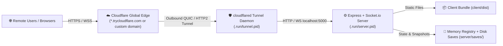

# Antigravity Canvas: Operations & Deployment Runbook (`RUNBOOK.md`)

This runbook establishes standard operating procedures (SOPs) for starting, monitoring, soft-restarting, and turning down the Antigravity Canvas real-time collaborative application and its Cloudflare Tunnel.

---

## 🏗️ Architecture & Dual-Process Model

Antigravity Canvas operates under a decoupled, two-tier architecture:



### Why Soft Restarts Preserve the Tunnel
* The `cloudflared` daemon maintains a persistent **outbound control connection** to Cloudflare edge data centers. The public hostname (`https://*.trycloudflare.com`) is leased and bound to the tunnel daemon session, **not** to the Node.js process.
* When the Node server restarts on `http://localhost:5000`, the `cloudflared` daemon remains alive and connected to Cloudflare. 
* Socket.io clients feature automatic exponential-backoff reconnection. When the server rebinds port 5000, clients seamlessly reconnect, rejoin their collaborative rooms, and auto-restore the latest state without changing the URL or refreshing the page.

---

## 📁 Operational Scripts Quick Reference

Automated scripts are located in `/scripts` supporting both Windows PowerShell (`.ps1`) and Unix/macOS Bash (`.sh`):

| Task | PowerShell Script | Bash Script | Description |
| :--- | :--- | :--- | :--- |
| **Start Server** | `.\scripts\start-server.ps1` | `./scripts/start-server.sh` | Starts Node server on port 5000 in background; builds `client/dist` if missing; verifies `/health`. |
| **Start Server (Rebuild)** | `.\scripts\start-server.ps1 -Rebuild` | `./scripts/start-server.sh --rebuild` | Compiles fresh Vite client bundle then starts backend. |
| **Start Tunnel** | `.\scripts\start-tunnel.ps1` | `./scripts/start-tunnel.sh` | Launches `cloudflared`, parses public URL, and writes to `.run/tunnel.url`. |
| **Soft Restart** | `.\scripts\restart-server.ps1` | `./scripts/restart-server.sh` | Restarts Node server **without severing the Cloudflare tunnel**; tests health through tunnel URL. |
| **Soft Restart (Rebuild)** | `.\scripts\restart-server.ps1 -Rebuild` | `./scripts/restart-server.sh --rebuild` | Rebuilds Vite frontend then restarts Node server without dropping tunnel. |
| **Inspect Status** | `.\scripts\status.ps1` | `./scripts/status.sh` | Displays live status, PIDs, memory usage, local health, and public tunnel edge connectivity. |
| **Stop Server** | `.\scripts\stop-server.ps1` | `./scripts/stop-server.sh` | Gracefully terminates server process and frees port 5000. |
| **Complete Teardown** | `.\scripts\stop-all.ps1` | `./scripts/stop-all.sh` | Shuts down both server and Cloudflare tunnel, cleaning up `.run` tracking files. |

> [!NOTE]
> All runtime process states, process IDs, and logs are tracked in `.run/` (ignored by git):
> - `.run/server.pid`: Node server process ID
> - `.run/server.log`: Server stdout output
> - `.run/server.err.log`: Server stderr / uncaught exceptions
> - `.run/tunnel.pid`: `cloudflared` process ID
> - `.run/tunnel.log`: Cloudflare tunnel connector output
> - `.run/tunnel.url`: Active public tunnel URL

---

## 🛠️ Step-by-Step Operational Procedures

### Scenario 1: Initial Launch (Cold Start)
To launch the application and expose it securely to collaborators over the internet:

#### PowerShell:
```powershell
# 1. Start the server (automatically builds client/dist if missing)
.\scripts\start-server.ps1

# 2. Launch the Cloudflare Quick Tunnel
.\scripts\start-tunnel.ps1

# 3. Check live status and retrieve public link
.\scripts\status.ps1
```

#### Bash:
```bash
./scripts/start-server.sh
./scripts/start-tunnel.sh
./scripts/status.sh
```

---

### Scenario 2: Soft Server Restart (Zero-Tunnel-Downtime Deployment)
Use this procedure whenever:
- Backend code in `server/` has been modified.
- Frontend code in `client/` has been updated and recompiled.
- Room memory needs a clean restart while clients keep their browser tabs open.

#### PowerShell:
```powershell
# Quick backend restart (keeps tunnel running)
.\scripts\restart-server.ps1

# Backend restart with fresh frontend client rebuild
.\scripts\restart-server.ps1 -Rebuild
```

#### Bash:
```bash
# Quick backend restart
./scripts/restart-server.sh

# Backend restart with fresh frontend client rebuild
./scripts/restart-server.sh --rebuild
```

#### What Happens Under the Hood:
1. `restart-server` inspects `.run/server.pid` and terminates only the Node.js process.
2. It waits up to 4 seconds to confirm port `5000` is completely unbound.
3. If `-Rebuild` was requested, Vite re-compiles the client into `client/dist`.
4. It starts the Node server with `server/server.js`, verifying `http://localhost:5000/health`.
5. It verifies that `cloudflared` is still running and tests connectivity through the registered public URL (`.run/tunnel.url`).
6. Connected browser clients automatically reconnect over Socket.io and rejoin their rooms.

---

### Scenario 3: Checking System Health & Diagnostics

```powershell
.\scripts\status.ps1
```

Sample output:
```text
==========================================================
📊 ANTIGRAVITY CANVAS RUNTIME STATUS
==========================================================

🖥️  Backend Server (Port 5000):
   Status:      🟢 ONLINE & HEALTHY
   Process:     node (PID: 55284)
   Local URL:   http://localhost:5000
   Health:      http://localhost:5000/health
   Memory:      42.15 MB

🌐 Cloudflare Tunnel:
   Status:      🟢 ACTIVE (PID: 45784)
   Public URL:  https://workers-adoption-myrtle-residence.trycloudflare.com
   Connectivity: 🟢 Edge reachable and routing traffic

==========================================================
```

To tail live server logs:
```powershell
# PowerShell
Get-Content -Path .run/server.log -Wait -Tail 30

# Bash
tail -f .run/server.log
```

To tail live tunnel logs:
```powershell
# PowerShell
Get-Content -Path .run/tunnel.log -Wait -Tail 30

# Bash
tail -f .run/tunnel.log
```

---

### Scenario 4: Graceful Shutdown (Turn Down)

#### Stop Server Only (Preserve Tunnel for Later Restart):
```powershell
.\scripts\stop-server.ps1
```

#### Complete Teardown (Stop Server and Close Tunnel):
```powershell
.\scripts\stop-all.ps1
```

---

## ⚙️ Manual Fallback Procedures

If executing scripts is restricted by environment execution policies, run these manual commands:

### 1. Manual Server Startup (PowerShell)
```powershell
# Load Node environment (fnm if applicable)
if (Get-Command fnm -ErrorAction SilentlyContinue) { fnm env | Out-String | Invoke-Expression }

# Build frontend bundle
npm --prefix client run build

# Start Node server
$proc = Start-Process node -ArgumentList "server/server.js" -PassThru -WindowStyle Hidden
Write-Host "Server running on PID $($proc.Id)"
```

### 2. Manual Tunnel Startup
```powershell
# Quick tunnel
cloudflared tunnel --url http://localhost:5000
```

### 3. Manual Soft Restart (Preserving Tunnel)
```powershell
# Find and terminate Node process listening on 5000
$conn = Get-NetTCPConnection -LocalPort 5000 -ErrorAction SilentlyContinue
if ($conn) { Stop-Process -Id $conn[0].OwningProcess -Force }

# Restart Node server
Start-Process node -ArgumentList "server/server.js" -WindowStyle Hidden
```

---

## 🔍 Troubleshooting & Edge Cases

### 1. `EADDRINUSE` — Port 5000 Already in Use
If the server fails to bind to port 5000:
```powershell
# Identify the process occupying port 5000
Get-NetTCPConnection -LocalPort 5000 | Select-Object LocalAddress, LocalPort, OwningProcess, State

# Force release
Stop-Process -Id <OwningProcessId> -Force
```
*(On macOS Monterey+, ensure **AirPlay Receiver** is toggled off in System Settings, or set `PORT=5001`).*

### 2. Cloudflare UDP / QUIC Network Blocking
In corporate networks or restricted Wi-Fi environments where UDP traffic is blocked, `cloudflared` may report `Initial protocol quic` timeouts.
- **Resolution**: Append `--protocol http2` to force fallback to TCP-based HTTP/2:
  ```powershell
  cloudflared tunnel --url http://localhost:5000 --protocol http2
  ```

### 3. State Recovery & Autosaves
- Transactional state is saved to disk every 2 minutes automatically and upon room close.
- Room snapshots are stored per room under:
  ```text
  server/saves/<roomId>/autosave.json
  server/saves/<roomId>/<saveName>.json
  ```
- When the server restarts, `roomManager.getOrCreateRoom(roomId)` automatically restores the latest save snapshot for that room. Elements, locks, custom folders, and user tabs are restored instantly.
